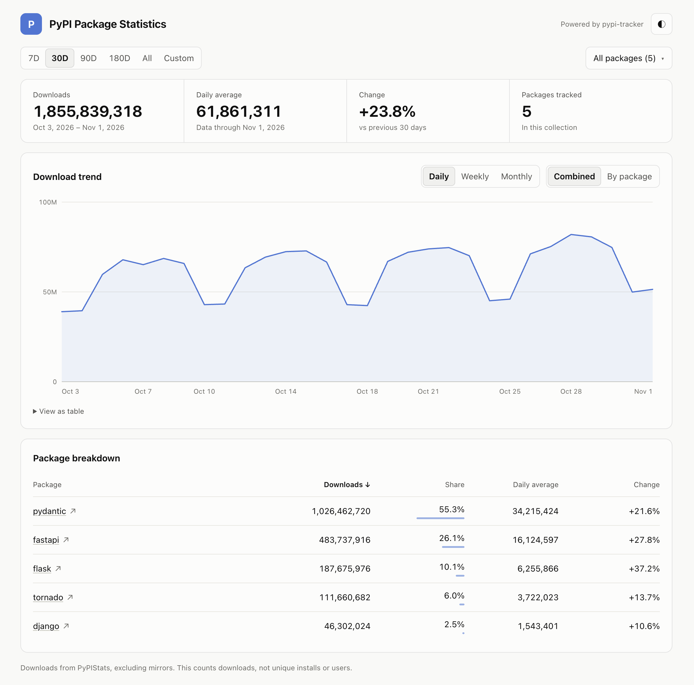

# pypi-tracker

pypi-tracker is a lightweight tool for collecting and preserving PyPI package download statistics. It maintains historical data beyond [PyPIStats](https://pypistats.org)' retention window. It generates static, chart-ready JSON reports that can be used to visualize download trends, track package adoption, and power dashboards or other applications without a backend.




## Try it

```bash
pip install pypi-tracker


pypi-tracker sync --package dj-control-room
```

You now have the full history in `data/dj-control-room.csv` and reports in
`public/packages/dj-control-room/` (`public/aggregate/` covers all your packages together, unless you use
[collections](#collections)), such as `last-30-days.json`:

```json
{
  "package": "dj-control-room",
  "report": "last-30-days",
  "as_of": "2026-11-01",
  "downloads": 38071,
  "complete": true,
  "observations": [
    {"date": "2026-10-03", "downloads": 510},
    {"date": "2026-10-04", "downloads": 757}
  ]
}
```

The `observations` list has one entry per day in the window (shortened here). A day with no data is `null`,
never `0`, and `complete` tells you whether any day is missing.

## Commands

| Command | What it does |
|---|---|
| `init` | Creates a starter config file. |
| `sync` | Runs `collect`, then `build`. This is the one to schedule. |
| `collect` | Fetches new data from PyPIStats and merges it into the CSVs. |
| `build` | Writes the JSON report files to publish. |
| `dashboard` | Runs `build`, then writes a static website that charts the reports. |
| `serve` | Runs `dashboard`, then previews the site locally, reloading it when anything changes. |
| `validate` | Checks the CSVs for bad data and missing dates. |

## Tracking several packages

You will typically want to keep a config file where you specify the packages you want to track.

```bash
pypi-tracker init  # generates a pypi-tracker.toml file, which commands in this directory then use
```

A complete config file will have the sections seen below. Note that the `pypi-tracker` also
allows for cli args that can supersede these config values; though typically it is much
easier to simply rely on a config file.
```toml
# pypi-tracker.toml
packages = [
    "dj-control-room",
    "dj-control-room-base",
    "dj-redis-panel",
    "dj-cache-panel",
    "dj-celery-panel",
    "dj-urls-panel",
    "dj-signals-panel",
]

[reports]
rolling_days = [7, 30, 90, 180]
calendar = ["weekly", "monthly", "yearly"]
historical = ["daily"]
summary = true
aggregate = true  # also report all packages combined

[dashboard]
enabled = true
title = "PyPI Package Statistics"

[storage]
directory = "data/"

[output]
directory = "public/"
```

You can update both reports and historical data by running a single `sync` command.
```bash
pypi-tracker sync --config pypi-tracker.toml
```

## Collections

Collections split your packages into groups, each its own page on the dashboard. Give one
`aggregate = true` when its packages belong together, like one product's packages, to get combined totals,
reports and badges for it. Leave it off for groups where a total means little, like web frameworks:

```toml
[collections.dcr]
title = "Django Control Room"
packages = ["dj-control-room", "dj-redis-panel", "dj-cache-panel"]
aggregate = true

[collections.frameworks]
title = "Web frameworks"
packages = ["django", "flask", "fastapi"]
```

With collections, nothing adds up all your packages at once. See the [guide](docs/guide.md#collections).

## Publish a dashboard

`dashboard` turns your history into a complete static website, ready for any static host. It needs no
backend and no configuration, though you can brand it:

```bash
pypi-tracker serve  # generates the site, then previews it at http://localhost:8000/
```

```toml
[dashboard]
enabled = true  # sync updates the site too
title = "Django Control Room"
description = "Download statistics across the DCR ecosystem"
logo = "assets/logo.svg"
accent_color = "#6366f1"
```

## Keep your CSVs

Run `sync` on a schedule and commit `data/`, because **the CSV files are your history**. If you lose them, or
stop collecting for longer than PyPIStats keeps data, those days are gone. History also can't reach back
further than PyPIStats did on your first run, so totals are "recorded" downloads, not lifetime downloads.

## More

The [guide](docs/guide.md) covers configuration, every report format, the Python API, and GitHub Actions and
Cloudflare Pages setup.

## Available reports

`build` writes these JSON files for each package to `public/packages/<package>/`, and for all packages
combined to `public/aggregate/` unless `aggregate = false`, or to `public/collections/<name>/` for each
[collection](#collections) with `aggregate = true`. The `[reports]` config section chooses which are generated.

| File | Contents |
|---|---|
| `summary.json` | First and last recorded dates, total recorded downloads and any coverage gaps. |
| `last-7-days.json`, `last-30-days.json`, `last-90-days.json`, `last-180-days.json` | Rolling windows: a total plus one observation per day, ending at the latest recorded date. One file per entry in `rolling_days`. |
| `weekly.json` | Totals for every ISO week, Monday through Sunday. |
| `monthly.json` | Totals for every calendar month. |
| `yearly.json` | Totals for every calendar year. |
| `daily/<year>.json` | Every recorded day in that year, such as `daily/2026.json`. |
| `badges/last-<N>-days.json` | A [shields.io](https://shields.io/badges/endpoint-badge) badge for each rolling window, such as "downloads/month: 38.1k". |

Aggregate rolling reports also include `breakdown`, each package's own numbers for that window. The
dashboard links to the files behind whatever it is showing.

Once `public/` is hosted, put a badge in any README by giving shields.io the badge file's URL:

```markdown

```
